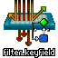
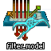
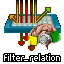
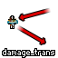
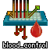

	
	
	
	

 

A filter tests a certain condition or set of conditions to filter through entities, like a `trigger_once` using a `filter_activator_name` that only allows an entity with the name "cow" to pass it. [Click here for more information on filters in Source.](https://developer.valvesoftware.com/wiki/Category:Filters)

In Mapbase, all filters have been given the following new I/O/KV:

### Inputs


### KeyValues


---
 

### New filters

Mapbase adds a few new filters so mappers could test more conditions:

<table id="entlist">
	<thead>
		<tr style="text-align: center;">
			<th style="cursor: pointer;" onclick="SortTableClassname()">Classname</th>
			<th>Summary</th>
		</tr>
	</thead>
	<tbody id="entlist_body">
	
	
	
	
	
	
	
	
	
	
	</tbody>

</table>

### Redirect filters

**Redirect filters** are a new "class" of filters that take a separate entity from the activator and pass it to another filter. For example, a `trigger_once` using a `filter_redirect_weapon` gets the activator's weapon and passes it to a `filter_activator_class`, which checks if it's a `weapon_pistol`.

<table id="entlist2">
	<thead>
		<tr style="text-align: center;">
			<th style="cursor: pointer;" onclick="SortTableClassname()">Classname</th>
			<th>Summary</th>
		</tr>
	</thead>
	<tbody id="entlist_body">
	
	
	
	</tbody>

</table>

---

### Damage manipulators

	
	
	

**Damage manipulators** are a family of filters designed to be used as damage filters, directly manipulating or operating with damage in some way. They don't actually filter anything themselves, but they can use a "secondary filter" to act as an actual damage filter or to control their behavior.

4 of these entities exist in Mapbase:

<table id="entlist3">
	<thead>
		<tr style="text-align: center;">
			<th style="cursor: pointer;" onclick="SortTableClassname()">Classname</th>
			<th>Summary</th>
		</tr>
	</thead>
	<tbody id="entlist_body">
	
	
	
	
	</tbody>

</table>

---

### filter_script

	

[**`filter_script`**](/docs/ents/filter_script/) is a special filter which allows filter functions to be controlled by VScript. See [VScript](/docs/vscript/) for more information on VScript in Mapbase.

